# Wrought dataset — what was learned dialling it in (2026-09-04 → 05)

The record of the two-day pass that took the Wrought race vocabulary from "renders something" to
"renders next to 002", the evidence for each step, the prompts that produced it, and the night run
that came out of it. Every claim below points at a frame in [`evidence/`](evidence/) or a JSON
record under `runtime/`. Where a number is quoted, the script that measured it is named.

**Source of truth for the look is one image:** `_locks/002_orc_teacher/plate.png`
(= `runtime/style/datasets/wrought_house_v1/images/002.png`). Utopic v10BF16, seed 1002, 52 steps,
CFG 3.5, euler/simple, AuraFlow shift 1.15, 768×1024. Not a prompt — a plate. Everything is graded
against it, and the owner's own note on it is the governing document:
[`002_REPEATABLE_FACTORS.md`](../../../runtime/style/datasets/wrought_house_v1/002_REPEATABLE_FACTORS.md).

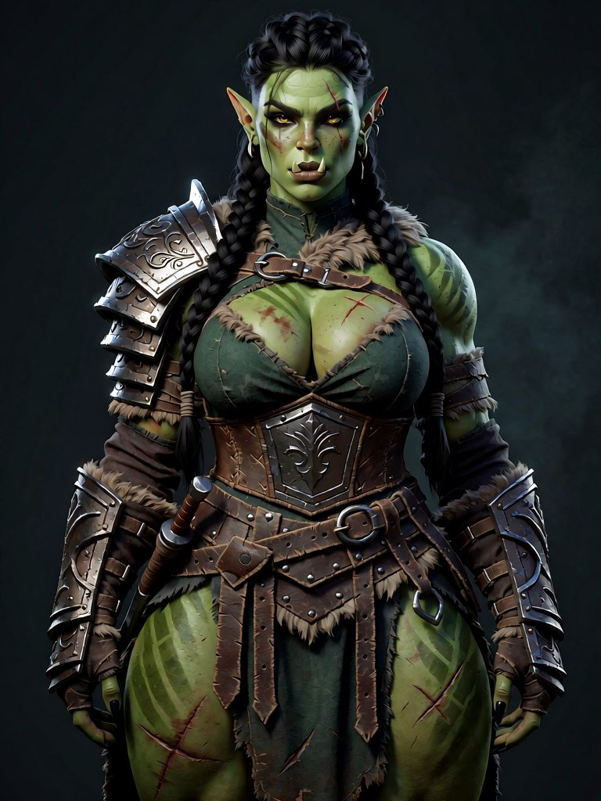

---

## 0. The finding that reorders everything else

**The owner had already graded most of this, and the vocabulary was authored without reading it.**

`runtime/style/datasets/wrought_house_v1/` holds his measured notes from August —
`KREA2_PROMPT_ENGINEERING.md`, `002_REPEATABLE_FACTORS.md`, `LESSONS_ORC.md`, `GOBLIN_10.md`,
`RACE_FEMALE_LOOK_LOCK.md` — plus the prompt pack and body cheatsheet one level up, and
`PICK.md` beside the locked plates. Four things the style block asked for were things he had
already graded as misses:

| the block asked for | the owner had graded | where |
|---|---|---|
| subject first, style last | *"house paint wants studio + PBR materials in the FIRST sentence, then the woman"*; subject-first plates *"went photoreal or anime"* | KREA2_PROMPT_ENGINEERING |
| `WROUGHT style` as the opening token | *"Never lead the prompt with the word WROUGHT — it burned in as gold title text"* (and it burned in here, on an axe blade) | LESSONS_ORC, GOBLIN_10, KREA2 notes |
| `painterly rendered surfaces` | W5 lock = *"002-lead + not painterly / not oil / not brushstrokes"*; every W4 nit is *"too painterly"* | KREA2_PROMPT_ENGINEERING |
| `controlled saturation, restrained palette` | *"Saturation is the game-character tell… NOT muted, not cinematic grade"*; bans `muted, desaturated, washed, grey-olive` | 002_REPEATABLE_FACTORS §4 |

That is where the photoreal drift the owner kept seeing came from. Not a mystery of the model —
a prompt asking for the graded failure. **Rule, now in memory: before authoring any prompt
vocabulary in this repo, read those files first.**

---

## 1. The instruments

Three scripts, all under `scripts/dev/`:

- **`generate_wrought_dataset.py`** — one race per invocation, reads materials/ornament/palette
  from the engine's `assets/content/cultures/<race>.ron`, draws a variation per frame from
  `wrought_variants.py`, renders through ComfyUI `/prompt`, fetches over HTTP `/view` (never a
  disk path — a remote endpoint's output dir is not this machine's), gates each frame, writes
  `NNN.png` + `NNN.json` (prompt, variation, seed, canvas, model, metrics, verdict).
- **`wrought_variants.py`** — the vocabulary. Race physiology (5e-grounded, then the owner's
  tweaks), the feminine invariant, dimorphism markers, heads, lineages, appearance tiers with the
  owner's floor, hair, clothing tiers, framing, light. Everything the owner edits lives here.
- **`check_wrought.py`** — the gate. Calibrated on the 17 locked plates, not chosen. Enforced:
  `detail_mid ≥ 0.030` (Class C floor — below it is anime-smooth / flat-lit), `material_floor ≥
  0.10` (no grimdark grade), `gloss_fraction ≤ 0.045` under `--organic`. Advisory: saturation
  (per-material law, whole-subject number), and — new tonight — face texture (§7).
- **`audit_wrought_night.py`** — the morning read: contact sheets per race, a drift sheet ranked by
  face texture, content-only captions beside every frame, one summary table.

Production config, measured against the model matrix on 09-04: **`loxsUtopicWorldKrea2_v20Quants`,
52 steps, CFG 3.5, euler/simple, shift 1.15**, canvas **768×1024 for portraits / 768×1344 for
figures** (the owner's locked sizes; the 832×1216 used before tonight matched no locked plate).

---

## 2. Peak beauty — "the objective, no matter who is looking, most beautiful women of each race"

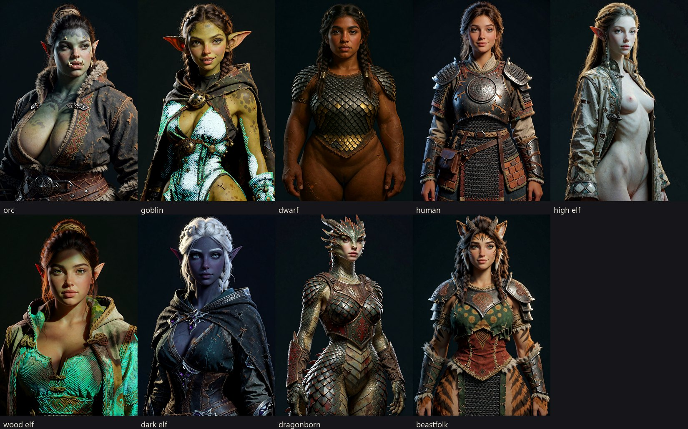

`--peak` collapses the distribution to its best case: mid-twenties, the STRIKING tier, a portrait
framing, a flattering key. The first STRIKING text said *"beautiful by her own people's
standards"* — the opposite of the instruction; it tells the sampler to grade on a curve. Now:
*"a strikingly beautiful face by any standard… beautiful regardless of who is looking."*

Per-race reads from the owner, and what changed: dwarf "looks like a short fat human" → proportion
stated in heads (§6); dark elf "old" → young, unlined, flawless; wood elf "malnourished" → athletic
with a soft layer; goblin refined toward small/delicate; dragonborn "human face on a bipedal
dragon" → §4. Tusks: the owner's rule *"female orcs should have smaller tusks"* was generalised into
a `DIMORPHISM` table — every race's signature feature has a sexed expression, because a tusk reads
in a portrait crop where hips do not.

Records: `runtime/wrought_dataset/<race>_peak_woman/`.

---

## 3. The suit pass — the wardrobe was carrying the silhouette

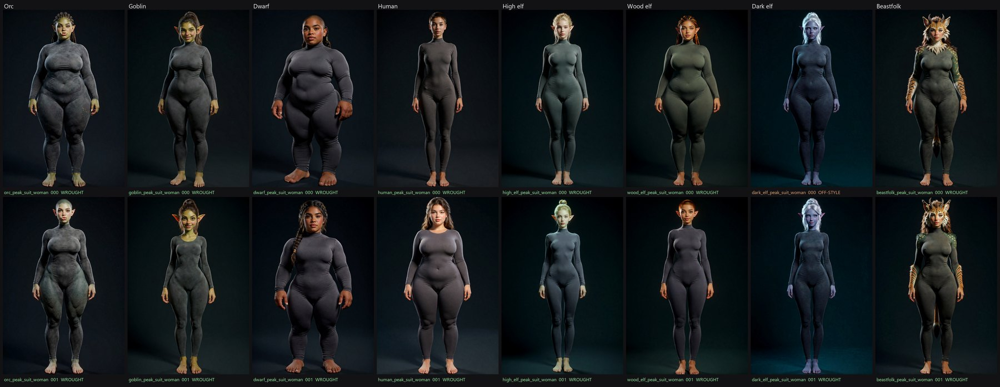

The standard clean-body garment: anthropometric scanning dresses a subject in a compression suit
because it adds a millimetre at the hip instead of a handspan, so the silhouette that comes out *is*
the body. The 002 regeneration met the same fact as a bug (a corset cinched the waist, pauldrons
squared the shoulders); a race judged in armour is judged in its armourer's taste. `--suit` swaps
only the garment and opens the framing to full body — the Wrought light law stays, because
`WROUGHT_NEG` forbids "flat lighting" by name and a flat-lit measurement frame would fail the gate
it is judged against.

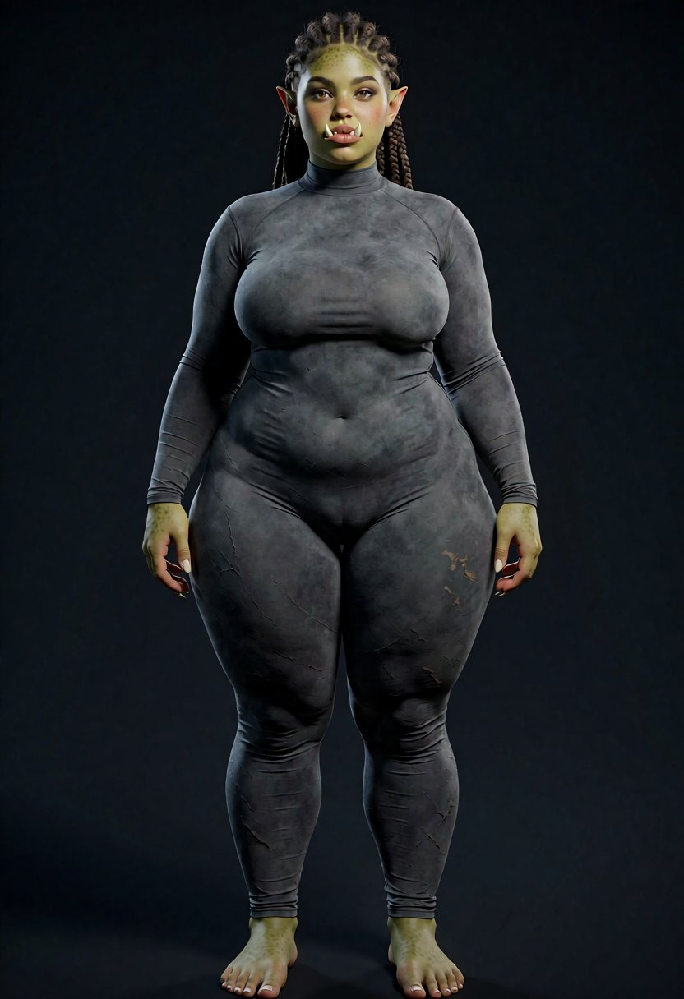

What the suit exposed, per frame record `orc_peak_suit_woman/000.json`:
- **Build was random across an 8-way list including "heavy and thick-set" and "slight and
  narrow"** — both ends PICK.md names as failures (*"not plus-size dump, not skinny stick"*), and
  `RACE_FEMALE_LOOK_LOCK` lists "one body for all races" as drift cause #1. Now `BUILD_BY_RACE`,
  the Vision Bible's own bands (Drow slim/lithe · elegant curvy · athletic-rogue; Goblin compact;
  Orc tall solid · warrior athletic · amazon curvy · lean raider; Human slim → amazon).
- **Orc tusks vanished** under "smaller, finer". LESSONS_ORC had recorded exactly this: *"Small
  tusks collapse to a white lip cut. Prompt 3D ivory tusks past the lip."* Now that phrasing.
- **Dwarf still read as a short human.** Breadth-versus-height language did nothing; both frames
  rendered a normal human head-count. Now stated the way figure drawing states it: *"about five and
  a half heads tall, short limbs against a long deep torso."*
- **Hands and feet human on every race**, dragonborn included. Open.

Prompt (suit, orc, seed 7700): `runtime/wrought_dataset/orc_peak_suit_woman/000.json`.

---

## 4. Dragonborn — four dragon heads, then the owner's reference

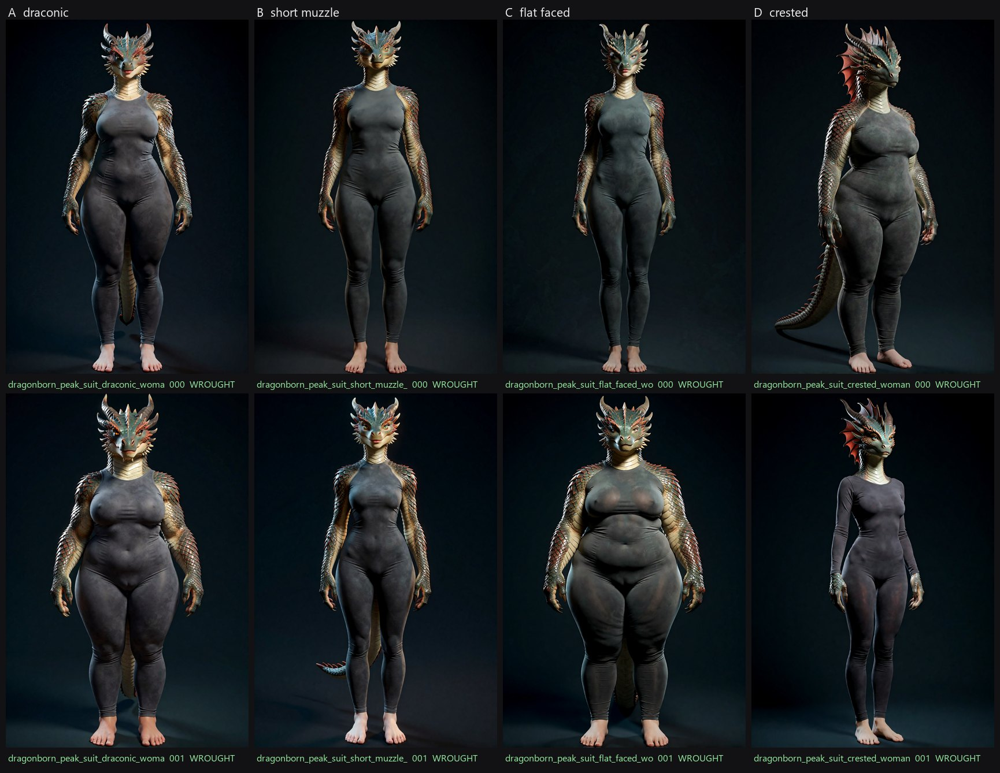

The owner's read of the peak sheet — *"a human face on what otherwise would have been a bipedal
dragon… we will need to refine the look to find a good hybrid"* — was read as *go fully draconic*,
and the head could not even be varied until it was pulled out of the three places it was written
(race `core`, the `female` line, `FEMININE_FACE_OVERRIDE`) into one `HEAD_VARIANTS` table.
A: draconic · B: short muzzle · C: flat faced (collapsed to A — "no muzzle at all" lost to the
model's one prior for a dragon head) · D: crested.

Then the reference:

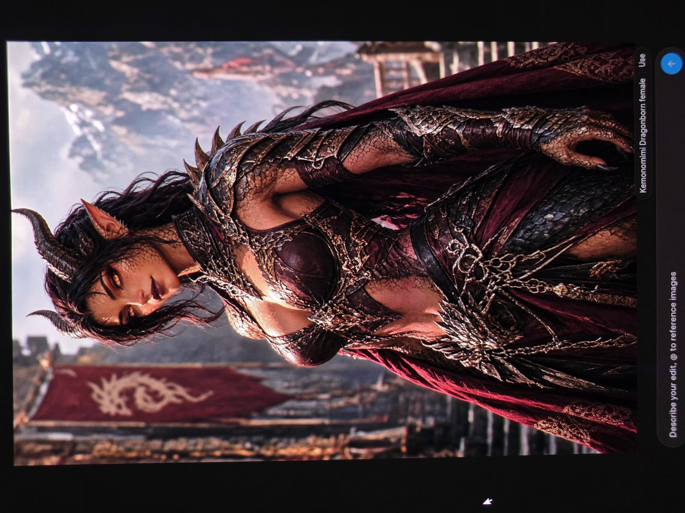

**Kemonomimi.** A human face carrying draconic features — scales as a skin treatment at the temples,
jaw and neck; ridged horns above the ears; long pointed ears; amber slit pupils; ordinary hair; the
scale and the claw pushed out to the limbs. The exemption had been mine: PICK.md and README state
the rule for the *world* (*"human face + ears/horns, NO ANIMAL HEADS"*), not for beastfolk. The
complaint was about a badly executed hybrid, not about hybridising. (The Vision Bible's row 7 says
"dragon head" — the owner's reference on 09-05 overrides it.)

Three dependents fell out rather than needing fixes: the feminine face override (a human face takes
`FEMININE_READ` like every other race), the horn-crest hair special case (hair follows the *head*),
and the full-hide scale description in the core (now says where the scale *lives* — heaviest at
forearms, shoulders, lower legs; lightest at the face).

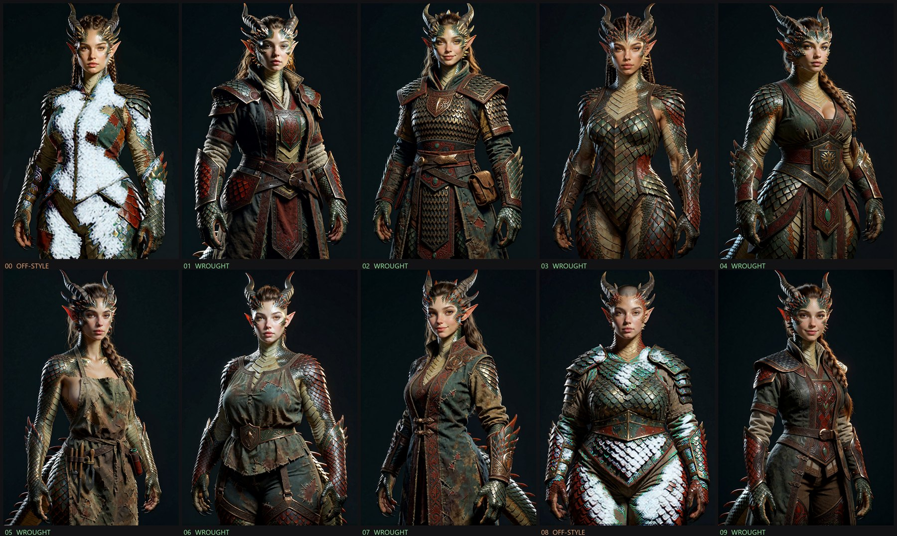

**The coverage lesson, learned twice in one hour.** First pass: 2 of 6 topless. The negative
`nude, topless, bare chest` already existed — in `SUIT_NEGATIVE`, so the one mode that *cannot*
produce the defect was the only mode defended. Moved to the shared negative: still 2 of 6. The
positive was already satisfied — an open riding coat over a bare torso *is* "wearing an oiled riding
coat". Stated: *"fully clothed, the garment closed and covering the chest, torso and legs
completely"* → 10 of 10 clothed. **A negative prunes; only the positive builds.** Third arrival of
that lesson here (the orthographic profile had to be described by its consequences; the appearance
tiers by their features).

Prompt: `runtime/wrought_dataset/dragonborn_peak_kemonomimi_woman/003.json`.

### Lineage

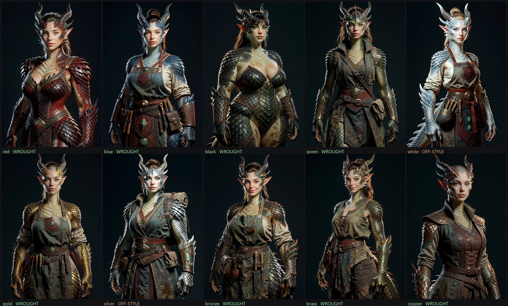

*"There are red blue and black dragonborn."* The core had hardcoded *"bronze slate green or dull
red"* — one smeared average — so no lineage could be asked for. `LINEAGE` now holds all ten 5e
ancestries, keyed by race (beastfolk pelts want the same shape), drawn uniformly so a batch covers
them, `--lineage` pins one. Two clauses had to stop owning a colour: the core (scale colour) and the
head (*"amber eyes"* contradicts blue's pale gold). **Each feature has one owner clause** — the same
conflict as crest-versus-hair, upper-left-versus-the-light-axis, and three tusk clauses on one orc.

White and silver failed the gate on gloss (0.099 / 0.088 vs 0.045): a pale scale under a hard key
blows the specular. Stated matte in their own text rather than loosening the rule for everyone.

---

## 5. The photoreal measurement

The owner's instruction for the night: *"diverting to photoreal need to be critically handled or
the night run will be a waste."* The gate had **no photoreal criterion** — its docstring says
"micro-pore photoreal pushes energy high", and `detail_high` was measured, reported and never gated.
Measured: **42 of 125 session frames sat above the locks' `detail_high` maximum (0.0511), and 38
of them passed.**

A ceiling on that number would not have fixed it. Three deliberate photograph probes (style block
replaced by an explicit DSLR request — the negative class the gate had never seen):

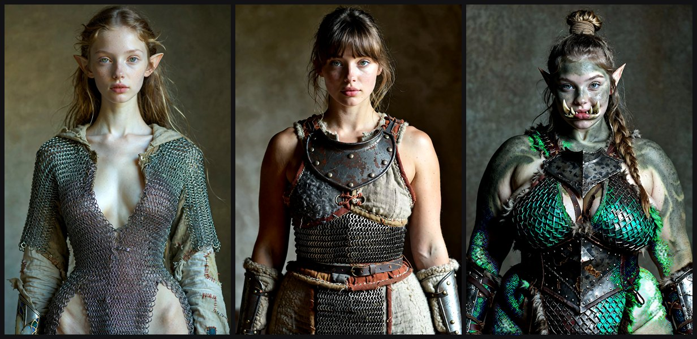

They measured `detail_high` 0.014–0.042 whole-subject — *inside* the locks' 0.0003–0.051.
Chainmail and scale are high-frequency and correct; a whole-subject band cannot tell a pore from a
rivet. That would have been the fifth whole-subject-number-for-a-per-material-law error in this
checker (gloss, crush, saturation floor, saturation ceiling before it).

The Look Matrix files micro-pore detail under §3 *Skin*, so the measurement lives on the face:
largest detected face, central 60% (cheeks, nose, brow), **native resolution** — `fine` = residual
under a 1.2 px blur (pore scale), `meso` = the 1.2–6 px band (form scale, Class C), ratio =
pore field against paint.

| set | `face_fine_over_meso` |
|---|---|
| photograph probes | 0.545 – 0.660 |
| locked plates (4 with a face ≥ 180 px) | 0.386 – 0.501 |
| early male orc batch (`runtime/wrought_dataset/orc/`) | 0.82 – 0.94 |

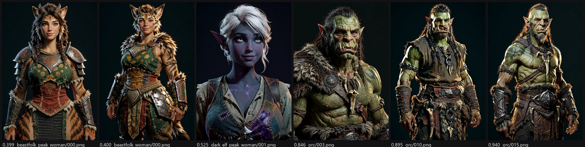

Lowest ratios are the beastfolk frames — clean paint-pocket skin. Highest are the early orc batch —
pore-mapped, wrinkled, the *"documentary skin"* 002_REPEATABLE_FACTORS names. **Recorded in every
frame's JSON as advisory with a band label, not a gate criterion:** four locks is too thin a sample
to fail a frame on, and the threshold is set from a labelled hundred in the morning, not from four
tonight. `check_wrought.py --calibrate` over the keepers gives it a real sample.

---

## 6. The prompt after the owner's findings (what the night run uses)

Before (peak, dragonborn, seed 8900 — `dragonborn_peak_woman/000.json`):

> a single dragonborn woman, … , palette of bronze, slate, deep red-ochre, jade, **WROUGHT style**,
> grounded stylized realism, PBR-native, … , **controlled saturation, restrained palette, painterly
> rendered surfaces**

After (verification, orc, seed 31001 — `runtime/wrought_verify/orc_woman/001.json`):

> **A single strong directional key light in a dark studio, deep readable form shadows, almost no
> fill, no rim light, no set. Worked materials: tooled leather with flex creases and stitching,
> rivets seated in straps, beaten engraved metal that highlights only on its edges, matte chalky
> cloth with readable weave. Selective realism, not a photograph, not pore-level skin, not oil
> paint, not painterly, not cartoon. Full punchy earth and iron colour, not muted, not cinematic
> grade.** a single orc woman, a young adult in their mid-twenties, about twenty-five, a lean
> raider's build, greyish-green skin, lower tusks, … small but clearly three-dimensional ivory lower
> tusks rising past the lip, finer than an orc man's, unmistakably female, … wearing layered
> lamellar over a long padded coat, well kept but used, fully clothed, the garment closed and
> covering the chest, torso and legs completely, … head and shoulders portrait, key light from the
> upper left, materials of this culture: wrought iron, leather, fur, bone, unfinished timber, worn
> surfaces, trophy ornament, palette of ash, iron gray, oxblood, feast ember, grounded stylized
> realism, physically based materials, material truth, … skin with living colour variation and no
> pore field, busy on the kit and simple on the void, same paint as the orc swordswoman plate

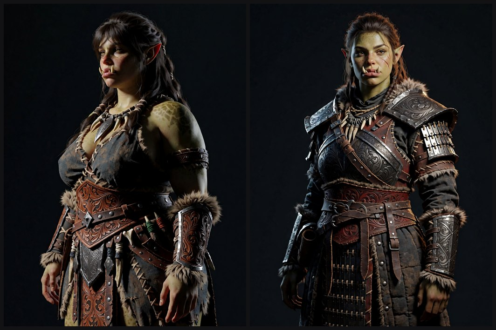
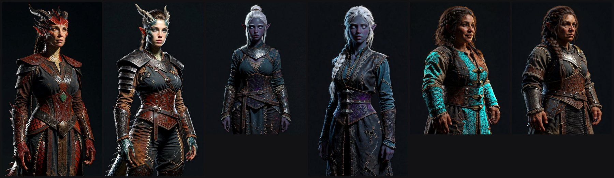

Also folded in from the same documents: no rim light and nothing lit from below (both graded
misses — `LIGHT_WEIGHTED`, upper-left ×4); always a full hairline (*"bald / shaved scalp =
unattractive"*); the mid-twenties, where PICK.md's 20–25 and LESSONS_ORC's 25–30 overlap; the old
age tier removed for women and WEATHERED made a men's appearance tier (the beauty bell has no tier
below ordinary-attractive); race-keyed `tail` negative; the house negative merged; dark-elf eyes
pupil-less and luminous per the Bible; goblin *"adult head-to-body proportion, not a doll"* per
GOBLIN_10 r3.

The two verification frames that drew old faces are what prompted the age trim. The dwarf's cyan
coat is the culture palette's `forge ember`/`gold` rendered hot — a saturation breach the advisory
number will flag; not fixed tonight.

---

## 7. The night run (launched 01:32, 2026-09-05)

900 women, 9 races, one sex per batch as the owner directed. `v20Quants` @ 52, canvases by framing,
organic gate, face texture recorded. Two boxes, **one runner per endpoint, distinct output roots**
(two runners into one root collided on frame index earlier today — the later finisher won):

| box | out root | jobs | frames |
|---|---|---|---|
| spellnode 192.168.1.127 (3090 Ti, ~1.5× faster than the 5090 on this model — measured, not assumed) | `runtime/wrought_night/` | orc, goblin, dwarf, high_elf, wood_elf, human×60 | 560 |
| 5090 local | `runtime/wrought_night_b/` | dark_elf, dragonborn, beastfolk, human×40 | 340 |

Logs: `_log_spellnode.txt`, `_log_5090.txt` in each root. Launched as **detached OS processes**
(`Start-Process`), not harness background tasks — those cap at a 10-minute timeout and an 11-hour
run cannot sit on the hope that the cap is ignored. Runner: `runtime/night_run.py` (health-polls the
endpoint before each race, waits up to 20 minutes if it is down, retries a failed race once).
Known wart: the runner's per-frame echo filters on a left-stripped line and prints nothing; the
JSON records are the log.

**Morning:**

```
.venv\Scripts\python.exe scripts\dev\audit_wrought_night.py runtime\wrought_night runtime\wrought_night_b --captions
```

→ `runtime/wrought_night/_audit/`: `_AUDIT.md`, `<race>_pNN.png` (20 a page, judge here),
`<race>_drift_top20.png` (highest face texture first — look here for photoreal), and an `NNN.txt`
caption beside every frame (trigger first, content only, per Doc 43 — the style is learned from the
pixels, not the words).

**Two independent reads in the morning.** Owner instruction at 01:50: if he has not surfaced by
10:00, Jarvis reads the frames as if he were the owner and writes his own assessment, and the
owner reads both. `scripts/dev/jarvis_assess_wrought.py` drives the engine's united model
interface (`SpellBound-Engine/tools/jarvis`, `stack.toml`): the vision role (gemma4:12b, local)
grades every frame of every finished race against the teacher plate, PICK.md and the 002
same-game test — one JSON verdict per frame, then a per-race write-up from its own verdicts. It is
shown no gate verdicts and no metrics. The reason role stays untouched tonight because
`stack.toml` binds it to the node's card, which is rendering. Outputs:
`runtime/wrought_night/_audit/_JARVIS_ASSESSMENT.md` and `_CLAUDE_ASSESSMENT.md`.

### Night log

- **01:32 / 01:33** — both runners up. First frames carry `face_fine_over_meso`; the verification
  frames rendered before the patch do not.
- **01:40** — first read of orc 000–008 (`runtime/wrought_night/_audit/orc_p01.png`, attempt 1).
  Three of nine read older and harder than the dark elves. Attributed from the records, not the
  eye: 002 and 004 drew the "weathered and old" age tier, 004 and 006 drew the WEATHERED
  appearance tier (both already removed for the races still to come), 003 drew "close-cropped
  practical hair" and rendered shaved. Dark elf 000–004: nothing to fix.
- **01:44** — women's hair now always a full hairline (`56f8078`, LESSONS_ORC: "bald / shaved
  scalp = unattractive"). **Orc restarted on spellnode** — 9 frames lost, 91 gained under the
  corrected distribution; orc is the flagship race. Attempt-1 log kept as
  `_log_spellnode_attempt1.txt`. Runner's per-frame echo fixed at the same time (it stripped the
  wrong side of the line and printed nothing); the 5090 runner keeps the old copy loaded, so its
  log stays terse until it restarts.
- **03:46** — orc complete (attempt 2), 100 frames at 73 s/frame on spellnode. Gate 91/100; the
  nine failures are gloss — three of them the v20Quants white-blowout artifact (093, 097, 023 —
  the gate catching what it exists to catch), the rest plate cuirasses and a brigandine throwing a
  legitimate specular under a hard key, which is the "skin rule applied to a helmet" category error
  `check_wrought.py` already records. Face texture: 41 measured, p50 0.476, p90 0.609, five above
  0.60 (089, 004, 026, 007, 066) — borderline to the eye, and far from the 0.82–0.94 of the batch
  that prompted the measure. Ages 61/29/10 young/thirty/middle. No coverage leak in 100.
  **The systematic defect the sheets show is one woman a hundred times** — same face, dark hair,
  olive skin (`orc_p01.png`, `orc_p03.png`). The green is weak too: many frames read as a tanned
  human with tusks. Both are the model's single prior filling every slot the prompt left open.
- **03:58** — identity axis (`skin / hair colour / eyes / face shape / nose`, per race, drawn),
  with the race cores' colour ranges moved into the tables so there is one owner clause
  (`f098832`). Orc's green is now explicit and varied (olive / forest / grey-green
  slate / deep green). Applies from dwarf onward on spellnode and dragonborn onward on the 5090;
  orc, goblin and dark elf carry the old single face. Captions carry skin/face/eyes.

---

## 8. Training — the researched path (not run)

Krea 2 is a single-stream MMDiT with Qwen3-VL-4B as text encoder and the Qwen-Image VAE
([technical report](https://www.krea.ai/blog/krea-2-technical-report)); the Utopic checkpoints are
Krea 2 finetunes in the same layout. The owner's Doc 43 rule stands — **train on RAW (or the Utopic
BF16 merge), never on Turbo; run daily on Turbo + LoRA** — and it matches the official guidance
([krea-ai/krea-2](https://github.com/krea-ai/krea-2)).

**Trainer: [musubi-tuner](https://github.com/kohya-ss/musubi-tuner/blob/main/docs/krea2.md)**
(kohya) has first-class Krea 2 support and is the community's recommendation over ai-toolkit for
VRAM behaviour on this architecture. Recipe from its docs:

- Models: DiT `.safetensors` (Utopic v20BF16 or `krea2_raw` — both on `D:/AI_ASSETS/models/
  diffusion_models/`), text encoder `qwen3vl_4b` single-file, VAE `qwen_image_vae`. All three are
  already on disk.
- Dataset TOML (`[general]`: `resolution=[1024,1024]`, `caption_extension=".txt"`,
  `enable_bucket=true`, `bucket_no_upscale=true`, `batch_size=1..2`; `[[datasets]]`:
  `image_directory`, `cache_directory`, `num_repeats`). Captions pair by stem — which is exactly
  what `--captions` writes.
- Pre-cache: `krea2_cache_latents.py --dataset_config … --vae …` then
  `krea2_cache_text_encoder_outputs.py --dataset_config … --text_encoder … --batch_size 1`.
- Train: `accelerate launch --mixed_precision bf16 krea2_train_network.py --dit … --vae …
  --dataset_config … --sdpa --timestep_sampling shift --weighting_scheme none
  --discrete_flow_shift 2.5 --optimizer_type adamw8bit --learning_rate 1e-4
  --gradient_checkpointing --network_module networks.lora_krea2 --network_dim 32 --network_alpha 32
  --max_train_epochs 16 --save_every_n_epochs 1`. Doc 43's numbers (rank 32, alpha 16, 1e-4→5e-5,
  1500–2500 steps) sit inside this; the official alpha is 32.
- VRAM levers if needed: `--fp8_base --fp8_scaled` (halves DiT), `--blocks_to_swap N`,
  `--sage_attn` (installed on both boxes). On the 5090 at 32 GB none should be needed at batch 1–2.
- Sampling during training on Turbo (`--turbo_dit …`, mu 1.15, 8 steps, CFG off) — RAW previews
  look flat by design; judge on Turbo.

Community pitfalls worth carrying
([chengyansen-ai/krea2-lora-training](https://github.com/chengyansen-ai/krea2-lora-training)):
`timestep_type linear` never `sigmoid`; test with euler/simple before blaming training for face
drift; a non-unique trigger pollutes the base — `wrought style` is common English, so consider a
rarer trigger alongside it; keep what is *fixed* out of the captions and describe only what
varies — for a style LoRA that means the style never appears in the caption, which is what Doc 43
already says.

**The rig, ready to run once picks exist** (`C:/sv_musubi/musubi-tuner`, own venv, torch 2.10
cu128, verified importing; `krea2_*` scripts present):

```
scripts\dev\collect_wrought_picks.py picks.txt      # race/NNN lines -> runtime/style/datasets/wrought_night_v1/train/
scripts\dev	rain_wrought_lora.ps1 -Name wrought_v1   # pre-cache + train, samples on Turbo; -DryRun prints the commands
```

**One blocker found by reading the loader, not by running it:** the only Qwen3-VL on disk is
`qwen3vl_4b_fp8_scaled.safetensors` (F:), and musubi's `_load_qwen3_vl_model` loads the state dict
strictly after key conversion — the 252 `weight_scale` tensors in a scaled-fp8 file are unexpected
keys and raise. Its fp8 path quantises *bf16* weights at load; it does not dequantise a pre-scaled
file. Training needs `qwen3vl_4b_bf16.safetensors` (Comfy-Org/Qwen3-VL, ~8 GB). Not downloaded —
that is a model pull and the rule is that those are the owner's call. The DiT is fine: Utopic
v20BF16 is bf16, and `-Fp8Dit` quantises it at load if VRAM needs it; the Quants DiT would hit the
same "already fp8" refusal and is not offered.

**Open before training:** the Bible lists 22 races (tiefling, tabaxi, wolf-folk…) and the
generator covers the 9 with culture files; the Bible has no dwarf at all. Confirm musubi loads the
Utopic merge (same layout — expected, not verified). Set the face-texture threshold from the
morning's labelled set before filtering on it.

---

## 9. Lessons, in the order they cost a render pass

1. **Read the owner's graded notes before authoring vocabulary.** §0.
2. **A negative prunes; only the positive builds.** Coverage, profile, attractiveness.
3. **Each feature has one owner clause.** Crest/hair, eye colour/lineage, light direction, tusks.
4. **A design fork written in three places cannot be varied.** Pull it into one table first.
5. **Measure the failure where the rule lives.** Photoreal is a skin rule → face region, native
   res. A whole-subject number for a per-material law has now been wrong five times.
6. **Calibrate on both classes.** 17 accepted plates encode their subject's accidents as laws;
   the probes are the first negative class the gate ever saw.
7. **One runner per endpoint, one output root per box.**
8. **Detach anything that outlives ten minutes.**
9. **The kemonomimi rule is for the world.** Don't carve exceptions the owner didn't ask for.
